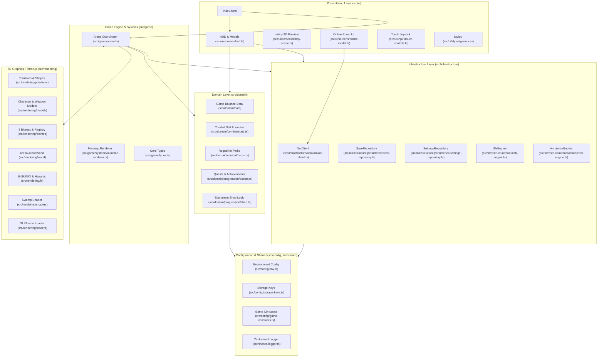

# Tài Liệu Thiết Kế Kiến Trúc Phần Mềm (Software Architecture Document)

**Dự án:** Hồn Việt 3D: Đấu Trường Danh Tướng  
**Phiên bản kiến trúc:** 2.0 (Enterprise Modular Architecture)  
**Tác giả:** Senior Software Architect  

---

## 1. Tổng Quan Kiến Trúc (Architecture Overview)

Dự án **Hồn Việt 3D** được xây dựng theo mô hình **Kiến trúc phân tầng kết hợp module hóa tính năng (Layered Feature-Driven Engine Architecture)**. Mô hình này giải quyết triệt để vấn đề "God File" và "Spaghetti Code" thường gặp trong các dự án game WebGL 3D, đồng thời phân tách rõ ràng giữa:
1. **Logic trò chơi thuần túy (Domain):** Độc lập hoàn toàn với Three.js canvas và DOM HTML, cho phép kiểm thử tự động độc lập.
2. **Hệ thống dựng hình 3D (Rendering):** Đóng gói Three.js Scene, Primitives, Mô hình Procedural, Shaders và Biomes.
3. **Điều phối thời gian thực (Game Engine):** Vòng lặp game, va chạm, đạn đạo, AI quái và hệ thống Minimap.
4. **Hạ tầng & Kết nối (Infrastructure):** Quản lý lưu trữ LocalStorage, tổng hợp âm thanh Web Audio, và WebSocket client.
5. **Giao diện người dùng (Presentation / UI):** HUD, sảnh chờ, popup kết quả và Virtual Joystick cho thiết bị di động.

---

## 2. Sơ Đồ Phân Tầng Hệ Thống (Architecture Diagram)

---

## 3. Chi Tiết Các Tầng Mã Nguồn

### 3.1. Cấu hình & Dùng chung (`src/config/`, `src/shared/`)
- `env.ts`: Quản lý các biến môi trường (`VITE_SERVER_URL`), chuẩn hóa URL WebSocket, regex kiểm tra mã bạn bè (`HV-XXXX`).
- `storage-keys.ts`: Tập trung hóa 100% các khóa lưu trữ `localStorage`, loại bỏ hoàn toàn tình trạng chuỗi hardcode nằm rải rác.
- `game-constants.ts`: Định nghĩa các hằng số không đổi: bán kính sàn đấu `ARENA_RADIUS = 40`, giới hạn zoom camera `[9, 36]`, số người chơi tối đa `4`.
- `logger.ts`: Cung cấp bộ ghi log tập trung có tiền tố và hỗ trợ tắt/bật theo môi trường dev/production.

### 3.2. Tầng Nghiệp Vụ & Dữ Liệu Thuần (`src/domain/`)
- **`domain/data/`**: Chứa toàn bộ dữ liệu danh tướng (9 tướng), vũ khí (7 loại), trang bị, quái vật, combo và thuật toán bố trí wave quái vật.
- **`domain/combat/`**:
  - `stats.ts`: Thuật toán `computeStats` biến đổi chỉ số tướng + vũ khí + cấp độ + trang bị thành chỉ số thực chiến (Máu, Giáp, DPS, Tốc độ, Tỷ lệ chí mạng).
  - `cards.ts`: Danh mục thẻ bài nâng cấp roguelike và cơ chế tung xúc xắc chọn thẻ khi lên cấp.
- **`domain/progression/`**:
  - `quests.ts`: 3 nhiệm vụ ngày tự động sinh theo ngày và hệ thống 13 thành tích tích lũy.
  - `shop.ts`: Logic mua vũ khí, nâng cấp cấp độ trang bị và mặc đồ.

### 3.3. Tầng Hạ Tầng (`src/infrastructure/`)
- **`network/net-client.ts`**: Đóng gói WebSocket Client với cơ chế phân phối sự kiện (Event Emitter), tự động kết nối lại, xác thực `secret token` và chuyển tiếp gói tin relay.
- **`persistence/`**:
  - `save-repository.ts`: Đọc/ghi và làm sạch an toàn (`sanitize`) dữ liệu người chơi.
  - `settings-repository.ts`: Lưu trữ âm lượng hiệu ứng, nhạc nền và độ zoom camera.
- **`audio/`**:
  - `sfx-engine.ts`: Bộ tổng hợp âm thanh hiệu ứng tức thời bằng Web Audio API.
  - `ambience-engine.ts`: Bộ tổng hợp âm thanh môi trường và thời tiết theo từng biome.

### 3.4. Tầng Dựng Hình 3D (`src/rendering/`)
- **`primitives/shapes.ts`**: Khối hình Three.js cơ sở (`mat`, `box`, `cyl`, `sph`, `cone`, `pivot`, `flashMaterials`).
- **`models/models.ts`**: Các hàm dựng mô hình 3D procedural: tướng, quái, vũ khí, hiệu ứng.
- **`biomes/biomes.ts`**: 8 môi trường thi đấu phong phú: Làng quê, Bãi tha ma, Rừng huyết mộc, Giông tố, Núi tuyết, Núi lửa, Sông Bạch Đằng, Động Phong Nha.
- **`world/arena-world.ts`**: Sàn đấu võ đài, ranh giới và bệ đấu.
- **`fx/`**: Kỹ năng phụ (`eskill-fx.ts`) và thiên tai (`hazards.ts`).
- **`shaders/swamp.ts`**: Shader bùn lầy và gợn sóng nước đầm lầy.
- **`loaders/glb-avatar.ts`**: Hỗ trợ nạp mô hình GLB bên ngoài.

### 3.5. Tầng Vòng Lặp & Điều Phối Trận Đấu (`src/game/`)
- **`arena.ts`**: Lớp điều phối trung tâm (Game Loop Coordinator) quản lý vòng đời trận đấu, trạng thái các đợt quái, phát hiện va chạm và kết nối giữa các thực thể.
- **`systems/minimap-renderer.ts`**: Hệ thống vẽ bản đồ nhỏ 2D độc lập trên HTML5 Canvas.
- **`types.ts`**: Khai báo toàn bộ cấu trúc dữ liệu thời gian thực (`Actor`, `Mon`, `Proj`, `Hud`, `Link`).

### 3.6. Tầng Giao Diện Người Dùng (`src/ui/`)
- **`screens/hud.ts`**: Quản lý HUD (máu, kinh nghiệm, thanh chiêu thức, đồng đội, boss bar, thông báo).
- **`screens/lobby-scene.ts`**: Cảnh xem trước 3D nhân vật và vũ khí tại sảnh chính.
- **`screens/online-modal.ts`**: Giao diện kết nối trực tuyến, sảnh phòng, chat và mời bạn.
- **`input/touch-controls.ts`**: Virtual Joystick và các nút bấm cảm ứng dành cho màn hình cảm ứng di động.
- **`styles/game.css`**: Toàn bộ định dạng giao diện đồ họa người dùng.

---

## 4. Backend Server (`server/`)

Backend được thiết kế theo kiến trúc Micro-Lobby nhẹ và an toàn:
- `config.mjs`: Tập trung hóa PORT, WS_PATH, RATE_LIMITS, LEADERBOARD path.
- `logger.mjs`: Ghi log có mốc thời gian và định dạng phân loại.
- `rooms.mjs`: Xử lý WebSocket connection, chống DDoS bằng Rate Limiter (token bucket), xác thực ID bạn bè bằng secret token để chống chiếm đoạt ID, và lưu trữ bảng xếp hạng top 30.
- `index.mjs`: Server HTTP tĩnh phục vụ file build kết hợp endpoint `/health` kiểm tra sức khỏe hệ thống.
- `test.mjs`: 47 ca kiểm thử tích hợp tự động cho mọi kịch bản phòng, sảnh và mạng.

---

## 5. Quy Ước Đặt Tên & Tiêu Chuẩn Viết Mã (Conventions)

| Loại tài nguyên | Quy ước | Ví dụ |
| :--- | :--- | :--- |
| **Thư mục (Directories)** | `kebab-case` | `domain/progression`, `infrastructure/persistence` |
| **Tệp TypeScript/JavaScript** | `kebab-case` | `save-repository.ts`, `minimap-renderer.ts` |
| **Classes & Interfaces** | `PascalCase` | `Arena`, `MinimapRenderer`, `Save3D`, `Actor` |
| **Functions & Methods** | `camelCase` | `computeStats`, `normalizeServerUrl`, `drawMinimap` |
| **Hằng số (Constants)** | `UPPER_SNAKE_CASE` | `STORAGE_KEYS`, `GAME_CONSTANTS`, `ARENA_RADIUS` |
| **CSS Classes & IDs** | `kebab-case` | `#hud-name`, `.center-card`, `.hud-tl` |

---

## 6. Hướng Dẫn Mở Rộng Tính Năng

### Thêm một Danh Tướng mới:
1. Mở `src/domain/data/index.ts` và thêm định nghĩa vào mảng `GENERALS` (chỉ số cơ bản, tên, ngoại hình, ultKind, eKind).
2. Mở `src/rendering/models/models.ts` để thêm ngoại hình 3D (nếu là tướng mới cần phụ kiện riêng).
3. Mở `src/rendering/fx/eskill-fx.ts` để thêm visual effect cho kỹ năng E nếu là chiêu thức đặc thù.
4. Chạy `npm run balance` và `npm run build` để kiểm tra độ cân bằng và tính toàn vẹn.
